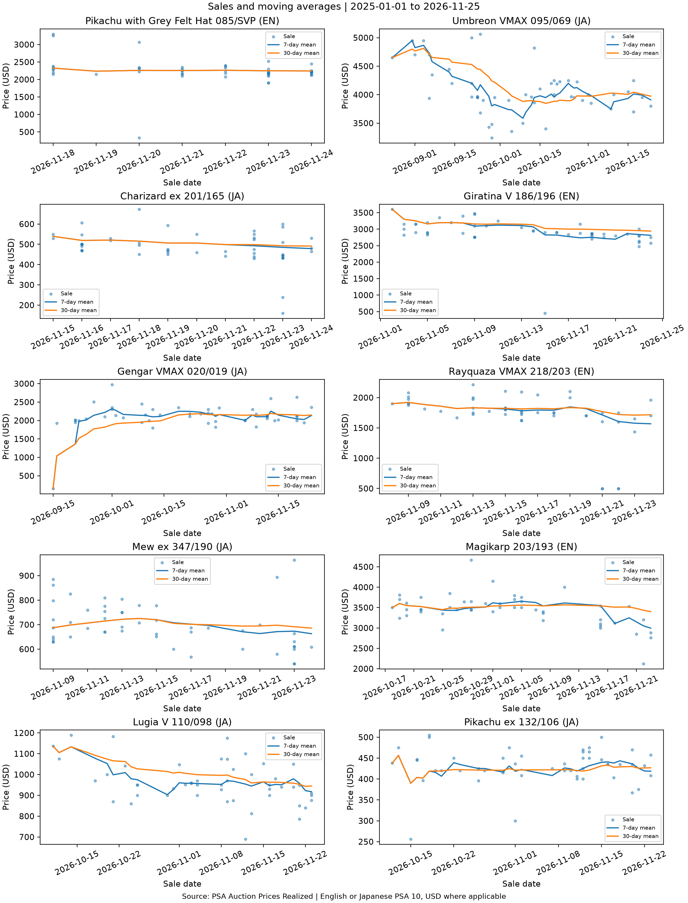
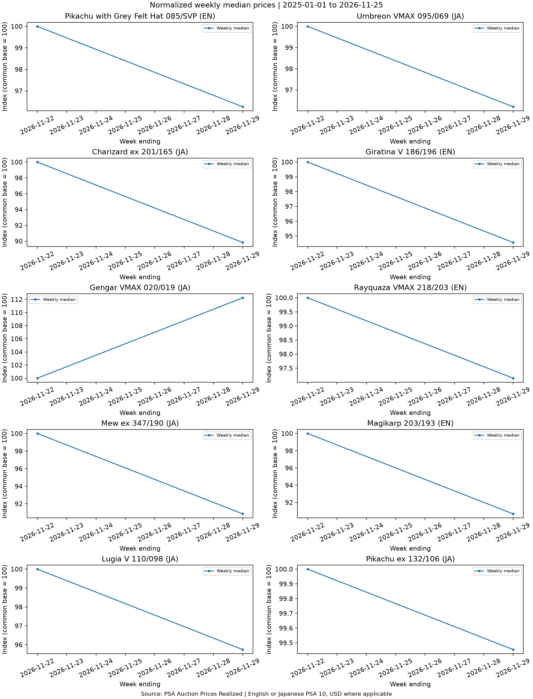
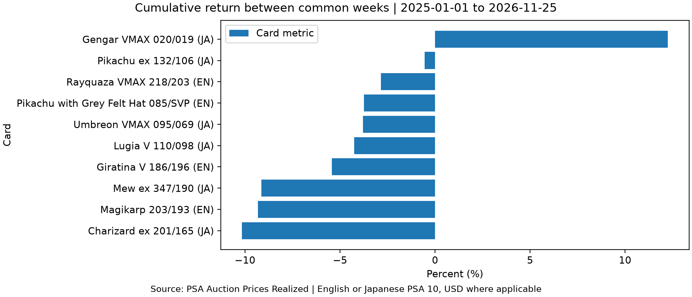
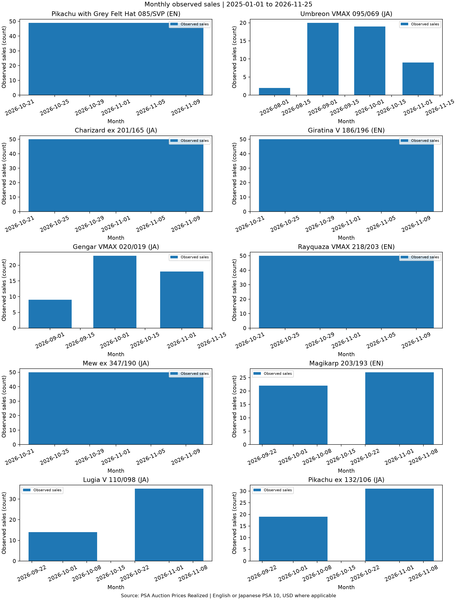
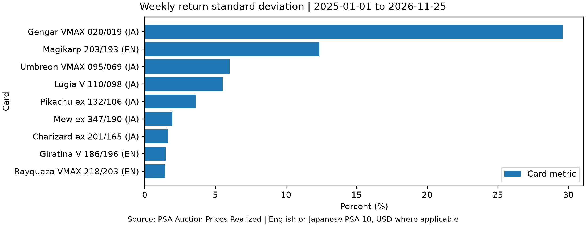
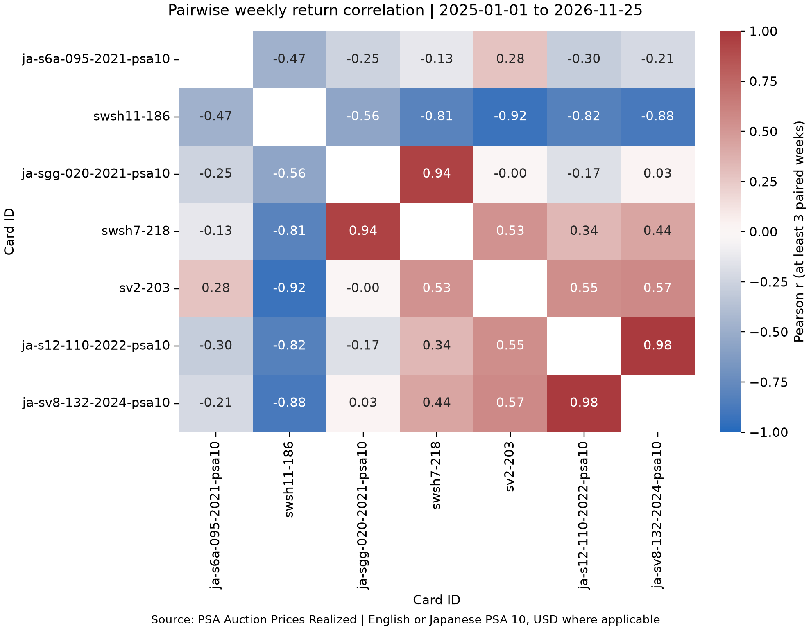
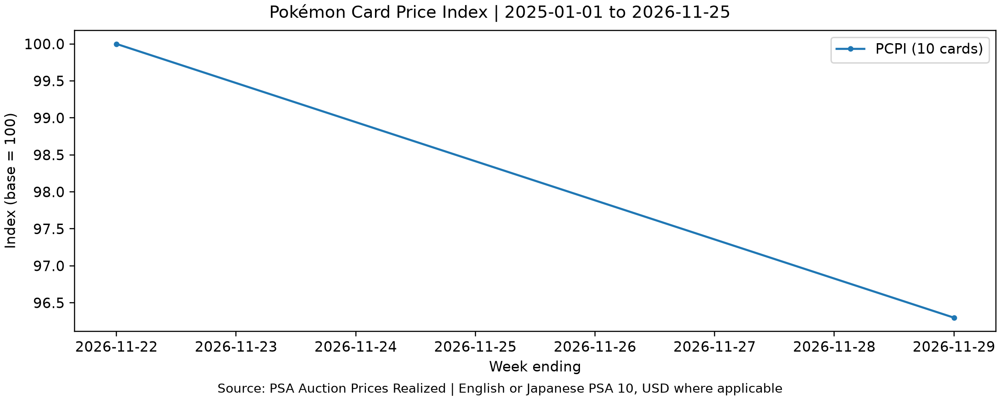
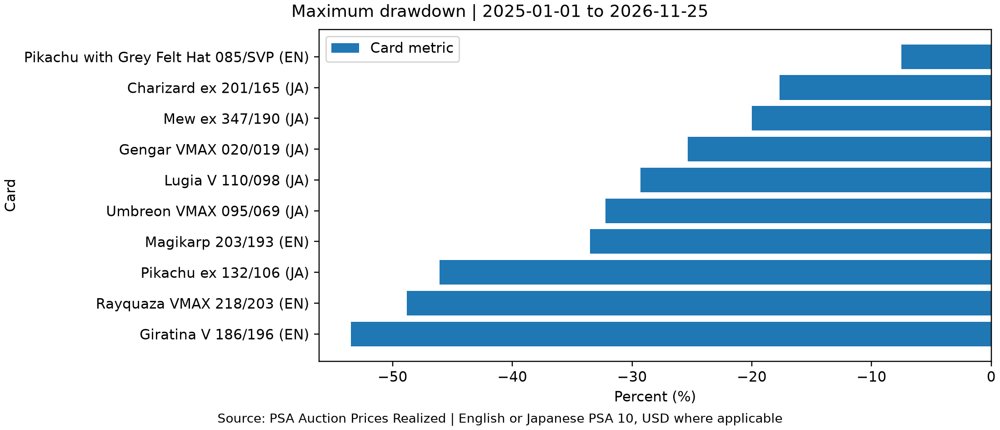

# Pokémon Card Market Analysis

## 1. 프로젝트 개요

영문판·일본판 PSA 10 포켓몬 카드의 USD 실거래 가격과 관측 거래량을 분석한다. 수치는 입력 CSV에서 검증된 관측에 근거한다.

## 2. 분석 주제 및 선정 이유

확장팩과 발매 시기가 다른 인기 카드의 수집 시장을 가격 흐름, 거래 빈도, 변동 위험의 관점에서 비교한다.

## 3. 분석 질문

1. 공통 기간 가격이 가장 많이 오른 카드는 무엇인가?
   2026-11-22~2026-11-29 공통 주에서 최고 수익률은 Gengar VMAX의 12.25%였다.
2. 관측 거래량이 가장 많은 카드는 무엇인가?
   가장 많이 관측된 카드는 Umbreon VMAX, Charizard ex, Giratina V, Gengar VMAX, Rayquaza VMAX, Mew ex, Pikachu ex이며 각각 50건이었다.
3. 주간 가격 변동성이 가장 낮거나 높은 카드는 무엇인가?
   주간 수익률 표준편차 최저는 Rayquaza VMAX 1.43%, 최고는 Gengar VMAX 29.59%였다.
4. 관측 거래량 변화와 가격 변화 사이에 상관관계가 있는가?
   수집 범위가 완전한 연속 주와 유효한 쌍 3개 이상이 필요하다.
5. 어떤 카드가 유사한 주간 가격 흐름을 보이는가?
   가장 높은 카드 쌍 상관은 Lugia V·Pikachu ex의 r=0.981, 6쌍이었다.
6. 주간 가격이 20% 이상 급등하거나 급락한 다음 주에는 어떤 변화가 나타나는가?
   급등 1건, 다음 주 유효 1건, 중앙값 10.34% · 급락 1건, 다음 주 유효 1건, 중앙값 -9.32%. 후속 표본이 있는 사건만 중앙값에 포함했다.
7. PSA 실거래와 PriceCharting 추정 시장 시세의 차이는 얼마인가?
   동일 카드·월에 PSA 거래와 PriceCharting 추정가가 모두 필요하다.

## 4. 분석 대상 카드 소개

|ID|카드|번호|확장팩|언어|
|---|---|---|---|---|
|svp-85|Pikachu with Grey Felt Hat|085/SVP|Scarlet & Violet Black Star Promos|en|
|ja-s6a-095-2021-psa10|Umbreon VMAX|095/069|イーブイヒーローズ|ja|
|ja-sv2a-201-2023-psa10|Charizard ex|201/165|ポケモンカード151|ja|
|swsh11-186|Giratina V|186/196|Lost Origin|en|
|ja-sgg-020-2021-psa10|Gengar VMAX|020/019|ハイクラスデッキ ゲンガーVMAX|ja|
|swsh7-218|Rayquaza VMAX|218/203|Evolving Skies|en|
|ja-sv4a-347-2023-psa10|Mew ex|347/190|シャイニートレジャーex|ja|
|sv2-203|Magikarp|203/193|Paldea Evolved|en|
|ja-s12-110-2022-psa10|Lugia V|110/098|パラダイムトリガー|ja|
|ja-sv8-132-2024-psa10|Pikachu ex|132/106|超電ブレイカー|ja|

## 5. 데이터 출처 및 수집 방법

이번 분석 실행의 거래 출처는 PSA다. PSA, CompSniper와 PriceCharting 데이터는 출처별로 분리한다.  [출처 검토](DATA_SOURCE_REVIEW.md)

## 6. 데이터 기본 정보

목표 범위는 2025-01-01~2026-11-25이다. 정제 후 PSA 실거래 497건, PriceCharting 실거래 0건, 추정 시세 0점이다. PSA 거래 100건 미만인 카드는 10종이다. [데이터 사전](DATA_DICTIONARY.md)

## 7. 결측치 및 이상치 처리

허용 기준 위반으로 제외한 행은 0개, IQR 경계 밖 표시 후 유지한 거래는 79건이다. 가격 결측은 빈 값으로 유지한다. 수집 확인일에만 무거래 0을 기록한다. 전후 건수와 제외 사유는 data_quality_report.csv에 기록한다.

## 8. 시계열 분석 방법

7·30일 달력 창의 일별 중앙값 평균으로 단기 노이즈를 완화한다. 주·월 중앙값은 각 거래에서 직접 산출한다. 연속 달력 구간만 변화율을 계산한다. 8주 이동 변동성은 유효 수익률 4개 이상에서 계산한다. 최대 낙폭은 관측 일별 중앙값의 이전 최고점 대비 하락률이다. Pearson 상관에는 유효 쌍 3개 이상이 필요하다. 추세는 이 기간의 가격 방향, 계절성은 반복되는 달력 주기, 노이즈는 단기 변동을 뜻한다. 여기서는 계절성 검정을 수행하지 않는다.

## 9. 시각화 결과

## 10. 카드별 분석 결과

|ID|PSA 거래|첫 거래|마지막 거래|관측 일 / 주 / 월|누적 수익률|주간 변동성|최대 낙폭|주간 수익률 / 거래량-가격 쌍|
|---|---:|---|---|---|---:|---:|---:|---|
|svp-85|49|2026-11-18|2026-11-24|7 / 2 / 1|-3.74%|산출 불가|-7.53%|1 / 0|
|ja-s6a-095-2021-psa10|50|2026-08-24|2026-11-23|40 / 14 / 4|-3.80%|6.00%|-32.22%|13 / 0|
|ja-sv2a-201-2023-psa10|50|2026-11-15|2026-11-24|10 / 3 / 1|-10.16%|1.64%|-17.68%|2 / 0|
|swsh11-186|50|2026-11-02|2026-11-24|22 / 4 / 1|-5.44%|1.48%|-53.48%|3 / 0|
|ja-sgg-020-2021-psa10|50|2026-09-15|2026-11-24|32 / 11 / 3|12.25%|29.59%|-25.37%|10 / 0|
|swsh7-218|50|2026-11-08|2026-11-24|17 / 4 / 1|-2.85%|1.43%|-48.80%|3 / 0|
|ja-sv4a-347-2023-psa10|50|2026-11-09|2026-11-24|15 / 3 / 1|-9.15%|1.95%|-20.00%|2 / 0|
|sv2-203|49|2026-10-18|2026-11-23|23 / 7 / 2|-9.32%|12.36%|-33.50%|6 / 0|
|ja-s12-110-2022-psa10|49|2026-10-11|2026-11-23|28 / 8 / 2|-4.26%|5.52%|-29.32%|7 / 0|
|ja-sv8-132-2024-psa10|50|2026-10-12|2026-11-23|30 / 7 / 2|-0.55%|3.61%|-46.09%|6 / 0|

## 11. 자체 가격 지수 분석

고정 바스켓은 영문판 4종, 일본판 6종이다. 표의 각 언어판을 전 분석 기간에 고정한다. [판본 선정과 자료 확보 상태](DATA_SOURCE_REVIEW.md)

2026-11-22에 100에서 시작했고, 2026-11-29의 지수는 96.30이다. 지수를 계산한 주는 2개다. 마지막 주의 날짜는 일요일 종료 라벨이며, 2026-11-25까지만 포함한 부분 주다. 첫 공통 관측 주의 카드별 중앙값을 각각 100으로 놓고 동일 가중치로 평균한다. 종목이 빠진 주의 지수는 결측이다. 선정 카드의 자체 지수이며 전체 시장 공식 지수가 아니다.

### 같은 10종의 eBay 지수 재계산

CompSniper/eBay의 고정 바스켓 거래는 925건이다. PSA 지수 2주, eBay 지수 0주가 산출됐고 양쪽 지수가 있는 날짜는 0개다. eBay 지수 · 결측. 한 주에 최대 8/10종만 관측했다.

각 출처의 첫 완전 관측 주를 각각 100으로 두었다. 서로 다른 기준 주에 정규화한 지수 수준을 직접 비교하지 않으며, 빠진 카드가 있는 주는 결측으로 둔다. 주별 누락 종목은 [출처별 PCPI 표](results/pcpi_by_source.csv)에 있다.

|카드|eBay 거래|관측 주|100건까지 부족|
|---|---:|---:|---:|
|Pikachu with Grey Felt Hat|525|38|0|
|Umbreon VMAX|12|8|88|
|Charizard ex|121|14|0|
|Giratina V|5|3|95|
|Gengar VMAX|36|30|64|
|Rayquaza VMAX|4|4|96|
|Mew ex|72|13|28|
|Magikarp|48|37|52|
|Lugia V|76|43|24|
|Pikachu ex|26|12|74|

## 12. 두 데이터 출처 비교

질문 7에 월별 매칭 결과를 기록한다. 같은 eBay 거래가 양쪽에 존재할 수 있어 양쪽 실거래를 합산하지 않는다.

### 2025년 표본

2025년에 확보한 관측은 출처별로 CompSniper 308건(2025-01-02~2025-12-30), Goldin 3건(2025-07-11~2025-10-19), PSA 2건(2025-12-28~2025-12-28)이다. 출처 간 거래 중복 가능성이 있어 합계를 제시하지 않는다. Goldin의 구매자 수수료 포함 가격과 eBay 가격은 별도로 보관했다.

### PSA와 CompSniper 교차 검증

PSA와 CompSniper의 eBay 상품 ID가 같은 기록 135건 중 날짜 일치 60건, 가격 일치 105건, 날짜·가격 모두 일치 44건이었다. 불일치 거래는 각 출처에 그대로 보관했다. 세부 대조는 ebay_source_summary.csv에 기록했다.

### 판본별 비교

두 판본 모두 PSA 100건 이상이고 공통 관측 주가 3개 이상인 검증된 쌍이 없다.

## 13. 주요 인사이트

### 질문 1

- 관찰 · 2026-11-22~2026-11-29 공통 주에서 최고 수익률은 Gengar VMAX의 12.25%였다.
- 근거 · 누적 수익률 그래프와 card_summary.csv.
- 해석 · 동일한 두 주의 거래 중앙값을 비교한 상대 성과다.
- 가설 · 중간 구간을 바꾸어도 순위가 유지되는지 확인할 수 있다.
- 한계 · 기준·종료 주의 판매 구성과 관측 건수에 민감하다.

### 질문 2

- 관찰 · 가장 많이 관측된 카드는 Umbreon VMAX, Charizard ex, Giratina V, Gengar VMAX, Rayquaza VMAX, Mew ex, Pikachu ex이며 각각 50건이었다.
- 근거 · 월간 관측 거래 그래프와 card_summary.csv.
- 해석 · 제공된 PSA 자료에서 해당 카드의 판매 기록이 가장 많이 나타났다.
- 가설 · 카드별 수집 범위를 맞춘 뒤에도 차이가 유지되는지 확인할 수 있다.
- 한계 · 거래 건수에는 출처와 수집 범위 차이가 반영된다.

### 질문 3

- 관찰 · 주간 수익률 표준편차 최저는 Rayquaza VMAX 1.43%, 최고는 Gengar VMAX 29.59%였다.
- 근거 · 변동성 그래프와 card_summary.csv.
- 해석 · 값이 큰 카드의 관측 주간 수익률이 더 넓게 흩어졌다.
- 가설 · 표본 주를 일치시키거나 등급 검증이 더 강한 거래만 남겨 비교할 수 있다.
- 한계 · 카드별 유효 주 수와 관측일이 다를 수 있다.

### 질문 5

- 관찰 · 가장 높은 카드 쌍 상관은 Lugia V·Pikachu ex의 r=0.981, 6쌍이었다.
- 근거 · 상관 히트맵과 두 상관 결과 표.
- 해석 · 두 카드의 유효 공통 주에서 계산한 동행 정도다.
- 가설 · 확장팩이 같은 카드의 상관이 추가 기간에도 유지되는지 확인할 수 있다.
- 한계 · 카드 쌍마다 분석 주가 다르고 상관계수로 인과를 판단할 수 없다.

### 질문 6

- 관찰 · 급등 1건, 다음 주 유효 1건, 중앙값 10.34% · 급락 1건, 다음 주 유효 1건, 중앙값 -9.32%. 후속 표본이 있는 사건만 중앙값에 포함했다.
- 근거 · price_shocks.csv의 사건별 다음 주 수익률.
- 해석 · 급변 직후에 관측된 변화의 중심과 방향을 비교할 수 있다.
- 가설 · 상승·하락 사건별로 평상시 다음 주 수익률과 비교해 차이가 유지되는지 확인할 수 있다.
- 한계 · 이벤트가 같은 시장 충격을 공유할 수 있고, 다음 주 결측의 영향도 남는다.

## 14. 결론

질문별 결과는 관측 거래와 공통 관측 주의 범위에서 해석한다.

## 15. 분석 한계점

관측 거래량은 자료에서 확인한 거래 건수다. 출처의 보고 범위 밖 거래, 거래 취소, 플랫폼 수수료와 배송비 포함 여부는 확인 가능한 범위에 의존한다. 카드당 목표 100건을 충족하지 못한 종목을 공개하고 대체 후보는 실제 자료를 확인한 뒤 선택한다.

## 16. 참고 자료

- [PSA Auction Prices Realized](https://www.psacard.com/auctionprices)
- [PriceCharting API 문서](https://www.pricecharting.com/api-documentation)
- [Pokémon TCG 영어 카드 목록](https://github.com/PokemonTCG/pokemon-tcg-data)

## 17. AI 활용 및 검증 과정

AI로 코드와 보고서 초안을 작성했다. 테스트용 관측은 임시 디렉터리에 격리했다. 결과를 검토할 때는 원본 행의 출처·등급을 대조하고 결과 CSV, 그래프의 축과 보고서 수치를 함께 확인한다.
